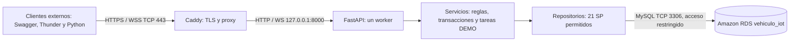

# Examen 2.6: implementación, comprobaciones y entrega

Actualizado el 20 de octubre de 2026. Base de la práctica 2.5:
`62ed35a18898fb9817abc282816292f22ec71675` en
[Jack28-08/api-vehiculo-iot](https://github.com/Jack28-08/api-vehiculo-iot).

La preparación en esta PC no acredita un despliegue público. Los scripts de
Windows se entregan para ejecutarse dentro de EC2; no se instalaron servicios,
se cambiaron ACL/firewall ni se ejecutaron nuevas escrituras en RDS desde esta
preparación. Las evidencias 2.5 conservan su fecha, alcance local y resultado.

## Objetivo y arquitectura

Publicar la API FastAPI con POO y sus 21 SP existentes en Windows Server de EC2,
con RDS MySQL, HTTPS y monitoreo WSS por vehículo. La aplicación debe funcionar
sin depender de VS Code o de mantener abierta una sesión RDP. No se requiere
ESP8266/ESP32 ni motores físicos para esta entrega.

Las rutas de lectura y el monitor son públicos; los POST requieren `X-API-Key`.
El operador ejecuta movimientos, inicia/cancela DEMO y detiene lógicamente. El
administrador también puede crear, actualizar y eliminar recursos. Un monitor
confirma el estado registrado en RDS; no demuestra conexión o actuación física
del microcontrolador. `conectado` conserva el valor almacenado.

El alumno eligió `184-72-72-255.sslip.io`. Su DNS A se comprobó desde esta PC;
el objetivo es `https://184-72-72-255.sslip.io/docs` y
`wss://184-72-72-255.sslip.io/ws/vehiculos/{id_vehiculo}`. Son direcciones
de despliegue pendientes de certificado y prueba pública, no URLs acreditadas
como operativas. Véanse [instalación Windows](../deploy/windows/README.md),
[operación EC2](operacion_ec2_windows.md) y el
[resultado de preparación local](verificacion_preparacion_2_6.json).

## Qué está comprobado y de dónde procede

| Alcance | Evidencia disponible | Lo que no demuestra |
| --- | --- | --- |
| Práctica 2.5 local | [GET reales](verificacion_http_get.json), [monitor de lectura](verificacion_websocket_lectura.json), [DEMO completa con dos clientes Python](verificacion_demo_real_completa.json); baseline de 124 pruebas aisladas | HTTPS/WSS público de EC2 o pruebas de Thunder Client |
| EC2 antes de esta integración | El alumno reportó capturas de Python/venv funcionales, 124 pruebas aisladas aprobadas, inspección de seis tablas/21 SP y API manual en loopback con ambos health `200` | Estado actual observado desde esta PC, servicio instalado, certificado público o persistencia tras reinicio |
| Preparación 2.6 | Scripts Windows, verificadores parametrizados, colección HTTP y guías versionadas | Resultado de ejecutar los instaladores en EC2 y de las pruebas públicas posteriores |

El estado de EC2 anterior procede del encargo y de las capturas descritas por el
alumno; no se presenta como una nueva sesión remota realizada por Codex. No hay
un canal RDP/SSM/SSH verificado en esta tarea. Deben completarse en EC2 la
instalación del servicio API, proxy, DNS/certificado y pruebas tras reinicio.

## Matriz de los 24 requisitos

Los estados distinguen implementación, preparación y evidencia. Una fila
«pendiente público» requiere comprobación real antes de marcarla cumplida.

| N.º | Requisito | Estado y material verificable | Evidencia pendiente de la entrega |
| --- | --- | --- | --- |
| 1 | Reutilizar Python, FastAPI y POO de 2.5 | Código en `app/`; [arquitectura HTTP](arquitectura_http.md); pruebas aisladas | Captura de la versión ejecutada en EC2 |
| 2 | EC2 conectado a RDS; seis tablas y 21 SP; MySQL restringido | Contrato versionado y conectividad EC2 reportada por el alumno | Captura actual de conectividad y reglas RDS desde el SG de EC2, ocultando datos privados |
| 3 | Persistencia al cerrar VS Code/RDP y reiniciar | Instaladores Windows preparados | Instalar, salir de RDP y probar desde otro equipo; reiniciar EC2 y repetir health/WSS |
| 4 | HTTPS para API/Swagger y WSS | Instalador Caddy; proxy loopback; DNS A del hostname elegido comprobado | Certificado válido y URLs HTTPS/WSS públicas funcionando |
| 5 | Conservar módulos y nombres/parámetros de los 21 SP | [Mapa HTTP-SP](mapa_endpoints_sp.md) y [guía de estudio](guia_estudio_21_sp.md); sin redefinir SP | Relacionar estas clases con las capturas de la aplicación en EC2 |
| 6 | GET, POST individual transaccional e historial máximo diez | Servicios y pruebas aisladas; evidencia local 2.5 | POST público y GET historial descendente contra la base actual |
| 7 | Estado inicial y POST hacia dos WSS del vehículo | Monitor implementado; dos clientes Python comprobados en 2.5 | Dos conexiones WSS públicas y evento individual del mismo POST |
| 8 | DEMO con N pasos reales, orden, tiempos y fin, sin historial | Ejecutor y [evidencia Python 2.5](verificacion_demo_real_completa.json) | Repetir por HTTPS/WSS y comparar todas las filas del historial desde RDS |
| 9 | Rechazar segunda DEMO y cancelar sin pasos posteriores | Coordinador por vehículo y pruebas aisladas; verificadores preparados | `409` al segundo inicio; cancelación confirmada y ausencia de nuevos pasos del UUID |
| 10 | Validación, permisos y secretos protegidos | Pydantic, roles, allowlist SP, parámetros enlazados y exclusiones Git | Capturas públicas de `401/403/404/409/422`; confirmar reglas AWS y permisos de servicio |
| 11 | Documentar rutas, respuestas, errores, SP y JSON WSS | Swagger, [protocolo](websocket.md), mapa y guía de estudio | Capturar Swagger público y ejemplos de la ejecución real |
| 12 | GitHub con código, dependencias y ejecución; sin secretos | Repositorio público previo; integración 2.6 preparada para commit/push auditado | Referenciar el commit final publicado de esta integración |
| 13 | Cliente externo y servicios disponibles al evaluar | Verificadores aceptan destinos explícitos | Ejecutar desde otro equipo y mantener EC2/RDS disponibles durante evaluación |
| 14 | Thunder: POST individual y dos WSS | [Guía Thunder](thunder_client.md), colección HTTP; 3.0.0 registrada localmente | Inicio de sesión permitido y capturas reales de Thunder; Python no sustituye este requisito por sí solo |
| 15 | Thunder: historial con hasta diez filas descendentes | Petición incluida en la colección | Captura de respuesta pública y explicación del límite y orden |
| 16 | Thunder: DEMO completa sin historial añadido | Secuencia preparada; comparación SQL de todas las filas prevista | Capturas de inicio/N pasos/fin, UUID y comparación antes/después |
| 17 | Evidencia 1: arquitectura y conectividad EC2-RDS | Diagrama y explicación de esta guía | Capturas AWS/Windows actuales, sin credenciales ni IP de acceso privado del alumno |
| 18 | Evidencia 2: Swagger HTTPS y GitHub | Repo público y despliegue preparado | Captura de `/docs` con certificado válido y enlace al commit final |
| 19 | Evidencia 3: inicial, POST, dos WSS y persistencia | Procedimiento descrito abajo y en guía Thunder | Capturas correlacionadas y lectura nueva de estado/historial |
| 20 | Evidencia 4: historial público y orden | GET mediante SP y recorte API, sin borrar RDS | JSON público de cero a diez filas; fechas/ID en orden descendente |
| 21 | Evidencia 5: DEMO, tiempos, estado final e historial intacto | Verificador y evidencias locales previas conservadas | Nueva evidencia pública, conteo/último ID y todas las filas idénticas |
| 22 | Word editable con portada, objetivo, arquitectura, capturas y PDF | Material técnico entregado; reporte se arma por separado con el alumno | DOCX y PDF finales con capturas propias y datos institucionales reales |
| 23 | Entregar GitHub, Swagger, WSS y PDF; servicios accesibles | GitHub conocido; hostname parametrizado | Añadir hostname/URLs certificados y PDF definitivos; comprobación final externa |
| 24 | Conclusiones propias y apuntes manuscritos de las «21 APIs» | [21 fichas de estudio](guia_estudio_21_sp.md) | Comprender, redactar conclusiones y escribir apuntes; confirmar con docente la denominación de 21 SP |

## Las tres pruebas funcionales

Elegir IDs mediante GET del destino público: vehículo activo, comando activo que
le pertenezca y DEMO con pasos reales. No reutilizar los IDs, las seis filas o el
último ID de la evidencia 2.5 como condiciones del examen. No ejecutar toda la
colección automáticamente: las operaciones POST cambian estado real y cada
movimiento individual añade historial.

| Prueba | Acción | Comprobación y captura |
| --- | --- | --- |
| Individual | Dos WSS del mismo vehículo; un POST con `id_comando` y `origen` identificable | Ambos iniciales coinciden con RDS; mismo evento `movimiento_individual`; HTTP `200`; estado e historial confirmados; nueva conexión de lectura ve la fila persistida |
| Historial | GET `/vehiculos/{id}/historial` | Como máximo diez filas en `fecha_hora DESC, id_historial DESC`; si hay menos, solo las disponibles; distinguir `[]` de vehículo inexistente `404` |
| DEMO | Snapshot completo del historial; dos WSS; un inicio `202` y UUID | Inicio + N pasos de RDS + fin en ambos; campos y esperas mínimas correctos, incluida la del último movimiento; estado final igual al último comando; historial completo antes/después idéntico |

El GET de historial no basta para demostrar ausencia de inserciones cuando hay
más de diez filas. Comparar `COUNT(*)`, último ID y todas las columnas/filas del
vehículo con conexiones nuevas de solo lectura a RDS, además de los hashes del
JSON normalizado. Mantener esa ventana sin otros POST individuales del vehículo.
Si falla una comprobación, conservar el resultado fallido: no convertirlo en
éxito ni repetir automáticamente un POST cuya persistencia se desconoce.

Complementos: un tercer WSS de otro vehículo no debe recibir los eventos del
primero; un segundo inicio durante la misma ejecución debe responder `409`;
probar cancelación en una ejecución separada, identificando su UUID. Al responder
la cancelación no puede quedar una operación RDS en curso ni aparecer un paso
posterior de ese UUID. Un evento anterior a la respuesta puede llegar almacenado
en una cola: registrar tiempos de recepción y correlacionar los mensajes.

## Reconexión, límites y microcontrolador

Un solo worker y sin `reload`: tareas DEMO, reservas y monitores son de ese
proceso. Tras reinicio se pierden sockets y tareas en memoria; el cliente vuelve
a conectarse y recibe `estado_inicial` obtenido del último estado persistido en
RDS. No se reanuda automáticamente la DEMO interrumpida. Consultar el estado real
antes de iniciar una nueva ejecución. No representar un `202` como finalización.

Un ESP8266/ESP32 podría conectarse por WSS al vehículo asignado, validar el
certificado y consumir los campos `tipo`, `id_comando`, `codigo`, `id_ejecucion`,
`orden`, `duracion_ms` y `pausa_ms`. Debería implementar reconexión y control de
duplicados. El monitor actual no recibe telemetría ni confirma ejecución física;
no asigna códigos de motor ni cambia `conectado` por abrir un socket. No colocar
una clave de administrador en un firmware de monitoreo.

## Material para el Word y PDF

Preparar portada institucional con datos reales, objetivo, arquitectura, versión
publicada, cinco grupos de capturas explicadas, seguridad, operación y enlaces
públicos. Cada captura debe indicar fecha/destino, acción, resultado y qué
requisito acredita. Ocultar claves y `.env`; mostrar `202` y UUID no constituye
por sí solo evidencia de fin de DEMO. Separar el intento fallido anterior de la
verificación local completa y de las nuevas pruebas públicas.

Redactar conclusiones propias: por qué la transacción usa dos SP, por qué DEMO
no añade historial, qué demuestran los eventos, qué cambia al reiniciar y qué
aporta TLS. Exportar el Word editable a PDF y revisar que diagramas/capturas y
URLs sean legibles. Esta integración no genera capturas ni un informe final
ficticio; el reporte con el alumno sigue pendiente.
