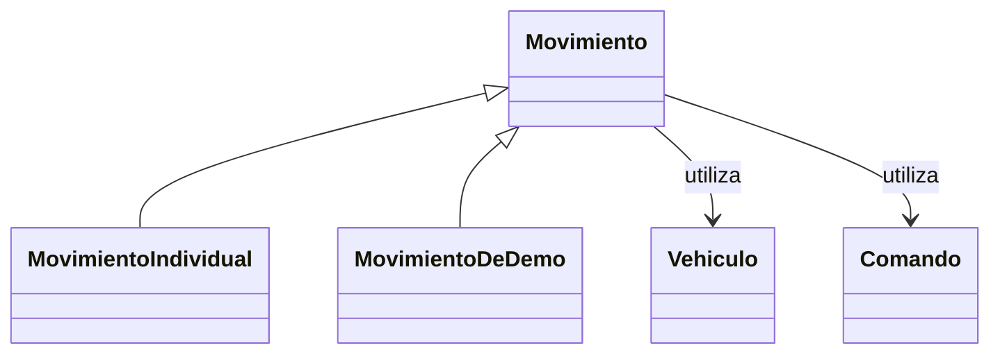

# POO aplicada a la API Vehículo IoT

Esta guía muestra objetos que intervienen en peticiones reales de la API. La
entrada continúa siendo `app.main:app` y se conserva el contrato de las 25
operaciones HTTP, el WebSocket y los 21 SP. La organización de Python se puede
revisar sin modificar las tablas, procedimientos o credenciales de RDS.

## Mapa para revisar el código

| Componente | Archivo | Responsabilidad |
| --- | --- | --- |
| `Vehiculo`, `Comando`, `Demo` | [app/domain/vehiculos.py](../app/domain/vehiculos.py) | Identidad, datos inmutables y reglas de actividad y pertenencia. |
| `Movimiento` | [app/services/movimientos.py](../app/services/movimientos.py) | Clase abstracta y algoritmo común de ejecución de un movimiento lógico. |
| `MovimientoIndividual` | Mismo archivo | Sobrescribe la política para registrar historial. |
| `MovimientoDeDemo` | Mismo archivo | Sobrescribe la política para no registrar ni consultar historial. |
| `VehiculoService` | [app/services/vehiculos.py](../app/services/vehiculos.py) | Casos de uso, bloqueo de filas, transacción y respuesta del movimiento individual. |
| `DemoDataService` | [app/services/demo_data.py](../app/services/demo_data.py) | Hereda del servicio y prepara/confirma pasos DEMO usando entidades y `MovimientoDeDemo`. |
| `VehiculoRepository`, `ProcedureExecutor` | [app/repositories/vehiculos.py](../app/repositories/vehiculos.py) | Adaptación a los SP y ejecución parametrizada de `CALL`. |
| `MySQLConnectionManager` | [app/database/connection.py](../app/database/connection.py) | Apertura, commit, rollback y cierre de recursos. |
| `VehiculoController` | [app/routes/vehiculos.py](../app/routes/vehiculos.py) | Veinte métodos de instancia para las operaciones originales. |
| `DemoController` | [app/routes/demos.py](../app/routes/demos.py) | Métodos de inicio, cancelación y detención lógica. |
| `HealthController`, `WebSocketController` | [Salud](../app/routes/health.py), [WebSocket](../app/routes/websocket.py) | Métodos de comprobación y de monitoreo. |

## Clases e instancias

Una clase define atributos y métodos. Una instancia es un objeto concreto de
esa clase. Por ejemplo, el módulo de rutas crea `controller =
VehiculoController()` y exporta `controller.router`. Durante la inicialización,
el controlador registra métodos como `self.ejecutar_movimiento`. FastAPI recibe
un método ya enlazado a la instancia: `self` no es un parámetro HTTP.

Las dependencias de autorización y servicio se siguen resolviendo con `Depends`.
El controlador compartido sólo conserva su router: no almacena una conexión,
una petición, una clave ni una transacción entre solicitudes.

## Encapsulación

`Vehiculo`, `Comando` y `Demo` usan `dataclass(frozen=True, slots=True)`: sus
atributos no se pueden reasignar por la interfaz normal de Python. Sus métodos
`exigir_activo`, `exigir_activa` y `exigir_pertenencia` concentran reglas del
dominio. La validación de forma y tipos del JSON sigue perteneciendo a los
modelos Pydantic de `app.models`.

`Movimiento` guarda `_vehiculo` y `_comando`, y los expone mediante propiedades
sin setter. `MovimientoIndividual` hace lo mismo con `_origen`. El prefijo `_`
declara uso interno por convención; Python no lo convierte en un control de
acceso de seguridad. La autenticación de la API es otra responsabilidad.

## Abstracción y herencia

`Movimiento` hereda de `ABC` y declara `_registrar_historial` con
`@abstractmethod`. No se puede instanciar la clase base mientras no se
implemente esa política. Su método `ejecutar` define el algoritmo compartido:

1. Verificar actividad del vehículo y pertenencia/actividad del comando.
2. Leer con bloqueo el estado anterior y conservar `conectado`.
3. Actualizar el estado con el repositorio recibido.
4. Invocar `self._registrar_historial(...)`.
5. Recuperar el estado y, cuando corresponda, el historial recién insertado.
6. Devolver `ResultadoMovimiento` al servicio dueño de la transacción.

`MovimientoIndividual` y `MovimientoDeDemo` heredan ese algoritmo. La primera
utiliza `super().__init__` para inicializar vehículo y comando, y añade el
origen. La segunda reutiliza la inicialización heredada.



`RepositorioMovimientos` es un `Protocol`: declara las operaciones que necesita
el algoritmo, sin obligar a que el repositorio herede de una clase concreta.
Es un contrato estructural de tipado; no verifica sus implementaciones en
tiempo de ejecución ni sustituye la clase abstracta `Movimiento`.

## Polimorfismo en la ejecución real

La llamada `movement.ejecutar(repository, connection)` utiliza el mismo
algoritmo, y `self._registrar_historial` se resuelve según la subclase:

| Instancia | Política | Uso real |
| --- | --- | --- |
| `MovimientoIndividual` | Invoca `registrar_historial` y recupera el registro insertado. | `VehiculoService.ejecutar_movimiento`, llamado desde el POST individual. |
| `MovimientoDeDemo` | Devuelve `None`; no llama a registro ni consulta de historial. | `DemoDataService.step`, llamado por el ejecutor durante cada paso DEMO. |

Las operaciones nunca confirman la transacción ni publican eventos. El contexto
de `MySQLConnectionManager.transaction()` confirma al salir correctamente y
revierte ante un fallo. La respuesta HTTP se entrega y el evento WebSocket se
publica después de esa confirmación. Si falla el registro individual, se revierte
también la actualización de estado.

## Composición e inyección de dependencias

`VehiculoService` utiliza un administrador de conexiones y un repositorio. Un
movimiento utiliza objetos `Vehiculo` y `Comando`. Cada controlador contiene un
router. Estas relaciones permiten construir el comportamiento utilizando
objetos colaboradores.

El servicio puede recibir esos colaboradores en su inicializador. En las
pruebas se sustituye el acceso SQL con dobles, manteniendo la lógica de negocio.
Las pruebas de DEMO también sustituyen `DemoDataService` por `FakeData`, cuyos
métodos compatibles permiten ejecutar el mismo coordinador sin RDS.

## Demostración local para la revisión

Desde la raíz del proyecto, con el entorno preparado:

```powershell
.\.venv\Scripts\python.exe -m scripts.demostrar_poo
```

El script instancia las entidades, un `RepositorioMemoria` y dos movimientos
de diferente subclase. Recorre ambos como objetos de tipo `Movimiento` e invoca
`ejecutar` con el mismo contrato. El resultado esperado es:

| Ejecución | Actualiza estado | Inserta historial | Total de historial al terminar |
| --- | --- | --- | --- |
| `MovimientoIndividual` | Sí | Sí | 1 |
| `MovimientoDeDemo` | Sí | No | 1 |

El modo de salida es `local_sin_rds`. No carga `.env`, abre puertos ni valida
el despliegue público. Sus IDs son ejemplos locales y no consultan el catálogo
real de AWS.

## Recorrido en Swagger y GitHub

1. Abrir `POST /vehiculos/{id_vehiculo}/movimientos` en Swagger y usar un comando
   real del catálogo, con la clave de operador o administrador.
2. Mostrar `VehiculoController.ejecutar_movimiento`: método registrado por una
   instancia que recibe datos validados y delega en el servicio.
3. Mostrar `VehiculoService.ejecutar_movimiento`: abre la transacción, obtiene
   las filas y crea `Vehiculo`, `Comando` y `MovimientoIndividual`.
4. Mostrar `Movimiento.ejecutar` y la sobrescritura de historial individual.
5. Mostrar `DemoDataService.step` y la sobrescritura de `MovimientoDeDemo`.
6. Consultar estado e historial desde Swagger. Para observar los eventos,
   conectar antes los monitores WebSocket. El movimiento individual agrega
   historial; la DEMO conserva el historial individual anterior.

La refactorización de POO no acredita movimiento de motores físicos. El
arranque público se comprueba aparte con la guía de operación de EC2.

## Pruebas

```powershell
.\.venv\Scripts\python.exe -m unittest discover -s tests -v
```

[test_poo.py](../tests/test_poo.py) cubre recursos inactivos y ajenos,
inmutabilidad, ambas políticas mediante la misma llamada, ausencia de acceso a
historial en DEMO, métodos enlazados y una petición HTTP que atraviesa el
controlador y el servicio reales con MySQL sustituido. Las suites existentes
siguen comprobando permisos, límites, rollback del segundo SP, coordinación y
eventos posteriores al commit.

La [verificación de esta refactorización](verificacion_poo.json) registra el
entorno y los resultados reales. En Linux se aprobaron 151 pruebas y se
omitieron 6 que requieren Windows PowerShell 5.1. La comparación completa de
OpenAPI conservó las 25 operaciones. También se corrigió el orden de cierre de
DEMO: se libera la reserva antes de publicar el desenlace, manteniendo el mutex
hasta encolarlo para conservar el orden respecto a una ejecución nueva. No se
realizó un despliegue ni una comprobación pública contra AWS en esta validación.
